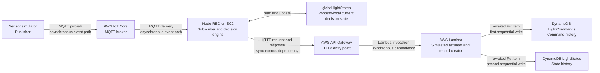
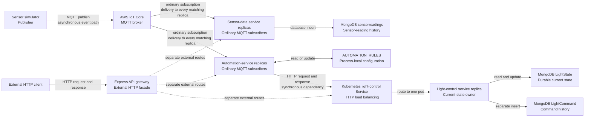

# Legacy Architecture Analysis

## 1. Purpose

This document reconstructs the 6.3D and 6.4HD lighting systems from available evidence.

The goals are to:

- understand how sensor events flowed through each system;
- identify state ownership and persistence;
- identify reliability and scalability problems;
- decide which lessons transfer to the air-conditioning controller.

The legacy architectures are evidence, not requirements for the new system.

## 2. Evidence Method

This analysis reconstructs the legacy systems using retained source code, configuration, report content, deployment screenshots, test results, and firsthand knowledge from the original developer.

### Evidence classifications

- **Repository-observed:** directly supported by a standalone source-code or configuration file retained in the repository.
- **Report-verified:** supported by source code, configuration details, test results, or deployment screenshots contained in the submitted report.
- **Author-confirmed:** confirmed from firsthand knowledge of the original implementation, but not fully preserved in the available artifacts.
- **Inferred:** a conclusion derived from the available evidence but not demonstrated directly.

When different artifacts conflict, the discrepancy will be recorded rather than silently choosing one version.

Source code and runtime configuration are generally stronger evidence of implemented behaviour than a high-level description.

The original AWS account is no longer available. Consequently, the historical deployment cannot be executed or queried, but the retained report provides enough evidence to reconstruct its main components and event flow.

### Evidence table

| Claim | Classification | Evidence | Notes |
| --- | --- | --- | --- |
| AWS IoT Core operated as the MQTT broker | Repository-observed and report-verified | Node-RED MQTT configuration, sensor/test code, and report architecture diagram | The live broker can no longer be queried |
| Node-RED sent commands to API Gateway using HTTP | Repository-observed and report-verified | Node-RED flow configuration and report screenshots | The report identifies the HTTP endpoint |
| Lambda wrote records to both DynamoDB tables | Report-verified | Lambda source code in the report appendix | The source performs one `PutItem` operation for each table |

## 3. 6.3D — Serverless AWS Architecture

The 6.3D AWS deployment no longer exists because the associated AWS account is unavailable.

However, the submitted report retains historical deployment evidence, including AWS console screenshots, configuration details, Lambda source code, Node-RED logic, database schemas, and test results.

This evidence is sufficient to reconstruct the implemented architecture, although the deployment can no longer be queried or executed for additional verification.

### 3.1 Component Inventory

| Component | What does it do? | Receives data from | Sends data to |
| --- | --- | --- | --- |
| Sensor simulator | Creates simulated light and motion readings | — | AWS IoT Core |
| AWS IoT Core | Acts as the MQTT broker, receiving publications and delivering them to matching Node-RED subscribers | Sensor simulator | Node-RED |
| Node-RED | Receives sensor readings, applies automation rules, and produces corresponding light commands | AWS IoT Core | API Gateway |
| API Gateway | Receives HTTP requests from Node-RED and routes them to AWS Lambda | Node-RED | AWS Lambda |
| AWS Lambda | Simulates light actuation and creates persistence records | API Gateway | DynamoDB |
| DynamoDB `LightCommands` | Stores command-history records | AWS Lambda | — |
| DynamoDB `LightStates` | Stores light-state-history records | AWS Lambda | — |

### 3.2 Event Flow



The diagram distinguishes the asynchronous ingestion path from the synchronous command-and-persistence path. It also shows that Node-RED's process-local cache, rather than DynamoDB history, is the state used to suppress unchanged decisions.

1. A compatible sensor simulator or test generator constructs a simulated reading and publishes it to AWS IoT Core.
2. AWS IoT Core routes the matching MQTT publication to Node-RED, which is hosted on an Amazon EC2 instance.
3. Node-RED applies the automation rules, compares the calculated state with its process-local cache, and emits a light command only when the calculated state changes.
4. Node-RED sends the command synchronously to API Gateway, which invokes AWS Lambda.
5. Lambda simulates applying the requested command and creates a command-history record and a light-state-history record.
6. Lambda writes the records sequentially to the DynamoDB `LightCommands` and `LightStates` tables.

### 3.3 State Ownership

State ownership identifies which component creates or changes a piece of information and where that information is stored.

| State | Created or changed by | Stored in | Survives a restart? | Purpose | Evidence |
| --- | --- | --- | --- | --- | --- |
| Sensor reading | Sensor simulator or test generator | Transmitted through AWS IoT Core and processed by Node-RED. It is not stored as an independent sensor-reading record. When a command is emitted, the reading is embedded in the corresponding `LightCommands` record as `sensorData`. | Only readings included in persisted command records survive. Readings that produce no command are not stored. | Provides motion and light-intensity input to the automation rules. | Sensor test code, Node-RED flow, and Lambda appendix |
| Current decision state | Node-RED decision engine | In-memory `global.lightStates` map inside each Node-RED instance | No. A Node-RED restart or instance replacement clears the cache. | Allows Node-RED to compare the newly calculated state with the previous calculated state and suppress unchanged commands. | Node-RED decision-engine code and report state-change analysis |
| Automation rules | Node-RED flow configuration | Deployed Node-RED flow and the configured EC2/AMI | Yes, under a normal process restart because the deployed flow remains on disk. It is separate from the in-memory state cache. | Calculates the desired power and brightness from motion, light intensity, and time of day. | Node-RED flow configuration and report appendix |
| Command history | Lambda creates the record; DynamoDB stores it | DynamoDB `LightCommands` table | Yes | Provides a durable audit trail of commands, including the action, reason, status, and associated sensor data. | Lambda source code and DynamoDB screenshots |
| Light-state history | Lambda creates the record; DynamoDB stores it | DynamoDB `LightStates` table | Yes | Records the simulated effective light state over time for traceability and debugging. | Lambda source code and DynamoDB screenshots |

#### State-ownership observation

The system has two different representations of light state:

1. Node-RED maintains an in-memory calculated state used for state-change detection.
2. DynamoDB maintains durable, time-stamped state-history records.

The Node-RED cache is not recovered from DynamoDB. Therefore, after a Node-RED restart, the first reading for each light is treated as a state change because no previous cached state exists. Node-RED emits a command and stores the newly calculated state for comparison with subsequent readings.

When multiple Node-RED instances are running, each instance has its own `global.lightStates` cache. The cache is not shared between instances. As a result, different instances may hold different previous states for the same light.

Persistent history exists in DynamoDB, but Node-RED does not use it to recover or share its decision state.

### 3.4 Synchronous and Asynchronous Communication

| Interaction | Communication style | Does the sender wait? | Effect of downstream failure | Evidence |
| --- | --- | --- | --- | --- |
| Sensor simulator → AWS IoT Core | Asynchronous MQTT messaging | The simulator may receive a protocol-level publish acknowledgement depending on MQTT settings, but it does not wait for Node-RED to process the reading or produce a light command. | The reading may fail to reach the broker. Recovery and redelivery depend on MQTT QoS and session configuration. | Sensor simulator, state-validation test, load-test code, and report architecture diagram |
| AWS IoT Core → Node-RED | Asynchronous MQTT publish/subscribe messaging | AWS IoT Core routes the message to matching Node-RED subscribers without waiting for the complete automation and persistence process. | If Node-RED is unavailable, whether the message is recovered depends on MQTT QoS and session configuration. Successful delivery does not prove that the later HTTP request or database writes succeeded. | Node-RED MQTT configuration and report architecture diagram |
| Node-RED → API Gateway | Synchronous HTTP request/response | Node-RED sends a command through the HTTP Request node and waits for an HTTP response, error, or timeout. | API Gateway or network failure prevents the command from reaching Lambda. Node-RED may already have updated its in-memory state cache before the HTTP operation fails. | Node-RED flow configuration and HTTP Request node |
| API Gateway → Lambda | Synchronous Lambda invocation | API Gateway waits for Lambda to finish and uses the returned status, headers, and body to construct the HTTP response. | A Lambda error or timeout causes the API request to fail and an error response to be returned to Node-RED. | API Gateway configuration and Lambda response structure in the report |
| Lambda → DynamoDB `LightCommands` | Synchronous dependency implemented with asynchronous JavaScript I/O | Lambda uses `await` and does not continue until the `PutItem` operation succeeds or exhausts its retries. | After the configured retries fail, Lambda throws an error. The `LightStates` write is not attempted because the writes are sequential. | Lambda `retryOperation` and first `PutItemCommand` in the report appendix |
| Lambda → DynamoDB `LightStates` | Synchronous dependency implemented with asynchronous JavaScript I/O | Lambda waits for the second `PutItem` operation before returning a successful response. | If this write fails, Lambda returns an error, but the earlier `LightCommands` record may already exist. This creates a possible partial-write state. | Lambda `retryOperation` and second `PutItemCommand` in the report appendix |

#### Direct Function Processing

Inside Node-RED, the decision-engine function processes the received MQTT payload within the Node-RED runtime. It extracts motion and light-intensity values, calculates the desired power and brightness, compares the result with the previous state stored in `global.lightStates`, and either emits a command or returns `null`. This processing does not cross a network boundary.

Inside Lambda, the handler parses the API Gateway event, extracts the light identifier and request body, simulates applying the requested command, creates the command-history and light-state records, and calls the retry helper for both DynamoDB writes. These operations are direct function calls within the same Lambda invocation, although the DynamoDB operations themselves cross a network boundary.

#### Communication Summary

The sensor-ingestion side of the system is asynchronous:

`Sensor → AWS IoT Core → Node-RED`

The command-execution and persistence side is a synchronous request-response chain:

`Node-RED → API Gateway → Lambda → DynamoDB`

The use of JavaScript promises and `async`/`await` in Lambda does not make the service interaction architecturally asynchronous. Lambda still waits for both DynamoDB operations before returning success to API Gateway.

### 3.5 Problems and Uncertainties

| Finding | Type | Evidence | Failure scenario | Consequence | Lesson for the rework |
| --- | --- | --- | --- | --- | --- |
| The standalone `sensor-simulator.js` is incompatible with the retained decision flow | Observed artifact mismatch | The simulator publishes to `test/topic` and produces `ambientLight`. The retained Node-RED decision flow subscribes to `iot/sensors/+/+/+` and expects `lightId`, `light_intensity`, and `motion_detected`. The state-validation and load-test scripts use the expected topic and fields. | The standalone simulator is started against the retained Node-RED flow. Its messages do not match the subscribed topic. Even if the topic were changed, its payload would still not satisfy the decision engine’s expected contract. | The intended automation path cannot be exercised reliably with the standalone simulator. Missing fields may also be converted into misleading default values rather than rejected. | Define one explicit, version-controlled sensor-event contract. Validate every incoming event and add contract tests proving that the simulator and consumer agree. |
| The exported flow and report describe different MQTT subscription modes | Historical configuration uncertainty | The retained `flows.json` subscribes to `iot/sensors/+/+/+`. The report describes a shared subscription using `$share/nodered/iot/sensors/+/+/+`. | Multiple Node-RED instances are started, but the actual deployed subscription configuration cannot be established from the surviving artifacts. | It is unclear whether each reading was distributed to one Node-RED instance or delivered independently to multiple instances. Consequently, the original scaling and duplicate-processing behaviour cannot be proven. | Store runtime configuration in version control and test the actual delivery behaviour. Documentation should describe the deployed configuration rather than a possibly different intended configuration. |
| Missing or malformed fields are silently converted into valid-looking values | Observed validation weakness | The decision function uses expressions such as `sensorData.light_intensity \|\| 0` and `sensorData.motion_detected \|\| false`, while `lightId` is used without validation. | A producer sends a misspelled field, an incomplete payload, or an unsupported value. | Invalid input can be interpreted as zero light, no motion, or an undefined light identifier. The system may make a legitimate-looking but incorrect decision instead of reporting a contract violation. | Validate untrusted MQTT payloads at the system boundary. Reject invalid events explicitly and record why they were rejected. |
| Current decision state is lost when Node-RED restarts | Observed problem | Previous calculated states are stored in the in-memory `global.lightStates` map. The map is not reconstructed from DynamoDB. | The Node-RED process, EC2 instance, or replacement instance restarts. | The first subsequent reading for each light is treated as a state change because no previous cached state exists. This can produce an unnecessary duplicate command even when the desired state has not actually changed. | Place correctness-critical state in durable storage or implement an explicit recovery process before handling new events. An in-memory cache should not be the only source of truth. |
| Current decision state is not shared between Node-RED instances | Observed design limitation | `global.lightStates` belongs to an individual Node-RED runtime. No shared state store or device-affinity mechanism is evident. | One instance processes a light’s first reading and caches its state. A later reading for the same light is delivered to another instance. | The second instance has no previous state and may emit another command. Different replicas can hold different views of the same light, making horizontal scaling affect correctness. | Before scaling a stateful consumer, define how state is shared or how all events for one entity are routed consistently. Scaling stateless computation is simpler than scaling per-instance mutable state. |
| Node-RED updates its cache before the downstream HTTP command succeeds | Observed correctness problem | The decision function calls `global.lightStates.set(lightId, newState)` before returning the message to the downstream HTTP Request node. | Node-RED calculates `ON` and updates its cache, but the request to API Gateway times out or Lambda fails. The next sensor reading produces the same desired state. | Node-RED believes that the new state has already been handled and suppresses the next command, even though the original command may never have reached the actuator or database. The cache represents the calculated intention rather than confirmed execution. | Distinguish desired state, issued command, and confirmed applied state. Do not mark an operation successful before its required downstream effect has succeeded. |
| Events and commands do not have an enforceable idempotency mechanism | Observed design problem | No stable producer-generated event identifier, idempotency key, or database uniqueness rule is evident across the complete path. A timestamp or database-generated record identifier does not identify two deliveries as the same logical event. | MQTT redelivers a reading, an HTTP client retries after a timeout, or Node-RED emits the same logical command again after losing its cache. | The same logical operation may create multiple command and state-history records or repeat an actuator effect. | Give each logical event or command a stable identifier. Enforce uniqueness in persistent storage and make repeated processing return the existing result without repeating the effect. |
| The two DynamoDB writes are not atomic | Observed correctness problem | Lambda awaits a `PutItem` for `LightCommands` and then separately awaits a `PutItem` for `LightStates`. The operations are sequential but are not one transaction. | The command-history write succeeds, but the state-history write fails after all retries. | The database contains a command record without the corresponding state record. Returning an HTTP error does not undo the first successful write, and retrying may create further records. | Persist related changes in one database transaction where the invariant requires all-or-nothing behaviour. Sequential `await` calls do not provide atomicity. |
| Sensor readings that do not create commands are not retained independently | Observed design limitation | A reading is embedded in `LightCommands` only when Node-RED detects a state change. The decision function returns `null` for unchanged states. | Engineers need to investigate why no command was issued or replay historical readings against corrected automation rules. | The system does not contain a complete history of its inputs. It can show emitted commands but cannot fully reconstruct every decision or non-decision. | Decide explicitly whether complete input history is required. If auditability, replay, or algorithm evaluation matters, persist readings independently from commands. |
| The exact historical AWS deployment can no longer be inspected | Evidence limitation | The original AWS account is unavailable, and some retained artifacts conflict with the report. | An engineer attempts to verify MQTT session behaviour, QoS, shared-subscription configuration, deployed Lambda version, permissions, or scaling configuration. | Some historical claims must remain report-verified, author-confirmed, or inferred rather than runtime-verified. The deployment cannot be reproduced solely from the retained repository. | Keep deployable infrastructure, configuration, schemas, and verification instructions in version control. A reproducible system should not depend on an inaccessible cloud account. |

#### Overall Assessment

The 6.3D system successfully demonstrated an end-to-end path from simulated sensor readings through MQTT-based ingestion, rule evaluation, an HTTP API, a Lambda function, and durable history records. It also demonstrated several useful ideas that should be retained, including asynchronous sensor ingestion, separation of automation logic from simulation, and persistent command history.

However, the system’s correctness depended on process-local state that was neither durable nor shared. That state was updated before downstream success was known. The absence of a stable idempotency mechanism meant that retries, redelivery, restarts, and horizontal scaling could repeat effects. The two related database writes could also produce a partial result. Finally, inconsistencies between the retained simulator, exported flow, and reported deployment made the system difficult to reproduce and verify.

These findings explain why the air-conditioning project should be a deliberate rework rather than a direct copy or technology substitution. The rework should prioritise:

1. one documented and runtime-validated event contract;
2. explicit ownership of current device state;
3. durable state required for correctness;
4. clear separation between desired, commanded, and confirmed state;
5. stable event and command identifiers;
6. idempotent processing enforced by database constraints;
7. atomic persistence of related changes;
8. reproducible local infrastructure and configuration;
9. failure-focused tests before horizontal scaling.

The goal of the rework is therefore not to reproduce the maximum number of AWS components. It is to build a smaller system whose behaviour remains explainable and correct during invalid input, duplicate delivery, downstream failure, application restart, and eventual scaling.

## 4. 6.4HD — Containerised Microservices Architecture

The 6.4HD implementation replaced the Node-RED and Lambda-based processing path with independently deployed Node.js services running in Kubernetes.

The architecture separated sensor-data persistence, automation decisions, light-state management, and external HTTP access. MongoDB provided shared durable storage, while AWS IoT Core remained the MQTT broker.

The implemented event path must be distinguished from the system's external HTTP API path. Automatic sensor processing through MQTT does not pass through the API gateway.

### 4.1 Component Inventory

| Component | Responsibility | Receives through | Sends through | State owned |
| --- | --- | --- | --- | --- |
| Sensor simulator and test generators | Simulate IoT devices and publish light-intensity and motion readings | Local simulation logic | MQTT publications to AWS IoT Core | Temporary simulation values such as battery level, generated readings, and connection state |
| AWS IoT Core | Operates as the MQTT broker and routes publications to matching subscribers | MQTT publications from sensor simulators | MQTT delivery to sensor-data and automation-service replicas | MQTT connection, subscription, and session state; no application-domain light state |
| Sensor-data service | Consumes and persists sensor readings and exposes APIs for querying them | MQTT directly from AWS IoT Core or HTTP through the API gateway | MongoDB writes and HTTP responses | Sensor-reading history stored in the `sensorreadings` collection |
| Automation service | Evaluates automation rules and calculates the desired light state | MQTT directly from AWS IoT Core or manual HTTP requests | Synchronous HTTP requests to the light-control service | Automation-rule configuration held in each process's memory |
| Light-control service | Compares the desired state with the persisted current state, updates the state, and records commands | Synchronous HTTP from the automation service or API gateway | MongoDB reads and writes and HTTP responses | Current light state and command history stored in MongoDB |
| API gateway | Provides one external HTTP entry point and forwards requests to internal services | External HTTP requests | Synchronous HTTP requests to the three internal services | No durable domain state; rate-limiting data is local to each gateway process |
| MongoDB | Provide persistent storage shared by the services | Mongoose queries and writes | Query results and write acknowledgements | Sensor readings, current light states, and command-history records |
| Kubernetes | Deploys, restarts, exposes, and horizontally scales service replicas | Deployment manifests, health probes, and resource metrics | Pod lifecycle management and internal HTTP load balancing | Desired deployment and orchestration state; no lighting-domain state |

#### Component-boundary observation

Despite its name, the sensor-data service does not behave as a sensor and does not forward readings to the automation service. The simulator represents the IoT device. The sensor-data and automation services subscribe to AWS IoT Core independently.

The automation service performs the decision-engine responsibility previously handled by Node-RED. The light-control service performs the simulated-actuation, current-state, and command-history responsibilities previously associated with AWS Lambda and DynamoDB.

The custom Express API gateway acts as an HTTP façade and reverse proxy for external clients.

### 4.2 Sensor-Event Trace



The two MQTT branches represent intentional fan-out between different responsibilities. The defect appears within each branch: every replica uses an ordinary subscription, so one publication may be processed by every replica of that service type. The API gateway is shown separately because it is not part of the automatic MQTT processing path.

| Step | Component | Input | Action | Output | State read or written | Evidence |
| ---: | --- | --- | --- | --- | --- | --- |
| 1 | Sensor simulator or test generator | Locally generated light and motion values | Constructs a JSON sensor-reading payload and publishes it to an MQTT topic | MQTT publication under `iot/sensors/...` or `test/topic` | Reads and changes only local simulation state | Simulator and test-generator source code |
| 2 | AWS IoT Core | MQTT publication | Matches the topic against active subscriptions and delivers the payload to subscribers | MQTT delivery to the sensor-data and automation services | Uses broker connection and subscription state | MQTT configuration in both subscriber services |
| 3A | Sensor-data service | MQTT topic and JSON payload | Parses the payload, constructs a `SensorReading`, and saves it | MongoDB insert | Writes a document to `sensorreadings` | `sensor-data-service/server.js` and `SensorReading.js` |
| 3B | Automation service | The same MQTT topic and JSON payload | Parses the payload and invokes `processAutomationRules` | Calculated desired light state and reason | Reads automation rules stored in process memory | `automation-service/server.js` |
| 4 | Automation service | Sensor fields and calculated desired state | Sends an HTTP `POST` directly to the light-control service | Light-state update request | No durable state written by the automation service | `axios.post` call in `processAutomationRules` |
| 5 | Kubernetes light-control Service | HTTP request | Routes the request to one available light-control pod | HTTP request delivered to a pod | No domain state | Kubernetes `ClusterIP` service configuration |
| 6 | Light-control service | Desired state, light identifier, sensor context, and reason | Reads the current light state and compares it with the desired state | Either an unchanged response or a state-change operation | Reads `LightState` from MongoDB | `POST /api/lights/state` implementation |
| 7 | Light-control service | Detected state change | Updates the current state and creates a command-history record | Updated state, saved command, and HTTP response | Writes `LightState` and `LightCommand` | Light-control service and Mongoose models |
| 8 | Automation service | HTTP response from light-control | Logs whether the state changed and completes processing | Processing completion | No additional durable state | Automation-service response handling |

The automatic path is therefore:

```text
Sensor simulator
    → AWS IoT Core
        ├──→ Sensor-data service → MongoDB sensor-reading history
        └──→ Automation service
                → Light-control service
                    → MongoDB light state and command history
```

The API gateway is not involved in this automatic MQTT path.

#### Separate HTTP Paths

The API gateway provides additional request-response paths for external clients:

```text
External client
    → API gateway
        → Sensor-data service
        → Automation service
        → Light-control service
```

These service routes do not all produce equivalent behaviour:

- `POST /api/sensors/readings` forwards a reading to the sensor-data service and stores it, but does not trigger automation.

- `POST /api/automation/process` manually sends a reading to the automation service, which then invokes the light-control service.

- `POST /api/lights/state` bypasses automation and sends a desired state directly to the light-control service.

- Query routes expose sensor readings, light states, command history, rules, statistics, and health information.

Consequently, publishing through MQTT and submitting a sensor reading through the HTTP sensor endpoint do not produce the same end-to-end effect.

### 4.3 MQTT Fan-Out

The sensor-data and automation services subscribe directly to `iot/sensors/+/+/+` and `test/topic`.

Each Kubernetes replica creates an independent MQTT client with a distinct client identifier. The subscriptions retained in the repository are ordinary, non-shared subscriptions.

With one sensor-data replica and one automation replica, one publication produces two intentional deliveries:

```text
One sensor publication
    ├──→ Sensor-data service: stores the reading
    └──→ Automation service: reacts to the reading
```

This fan-out is valid because the services perform different responsibilities. The problem occurs within each service type when it has multiple replicas using ordinary subscriptions.

The Kubernetes deployments initially configure three sensor-data replicas and three automation-service replicas. Because every replica uses an ordinary subscription, one publication can be delivered to all six matching subscribers:

```text
One sensor publication
    ├──→ Sensor-data pod 1
    ├──→ Sensor-data pod 2
    ├──→ Sensor-data pod 3
    ├──→ Automation pod 1
    ├──→ Automation pod 2
    └──→ Automation pod 3
```

Possible results include:

- three sensor-reading insertions;
- three executions of the same automation rules;
- three HTTP requests to the light-control service; and
- duplicate or conflicting command-processing attempts.

Adding an MQTT-consuming replica therefore adds another subscriber and can multiply work instead of distributing the existing workload. This differs from a competing-consumer or work-queue model, in which multiple workers share a workload and only one worker receives a particular delivery.

#### Solutions

The appropriate MQTT organisation would use one shared-subscription group for each service responsibility:

```text
Sensor-data replicas:
    $share/sensor-storage/iot/sensors/+/+/+

Automation replicas:
    $share/automation/iot/sensors/+/+/+
```

For one publication, AWS IoT Core would select one member of the `sensor-storage` group and one member of the `automation` group. The service types must not use the same shared-group name. If they belonged to one group, they would compete with each other, so an event might be stored without being automated or automated without being stored.

Shared subscriptions distribute deliveries within a group, but they do not guarantee exactly-once processing. Retries, connection failures, or producer resubmission can still result in repeated delivery. Stable event identifiers and idempotent consumers therefore remain necessary.

### 4.4 State Ownership and Race Conditions

| State | Owner and storage location | Behaviour across replicas | Correctness risk |
| --- | --- | --- | --- |
| Sensor-reading history | Sensor-data service writes to MongoDB `sensorreadings` | All replicas share MongoDB, but ordinary MQTT subscriptions cause every replica to receive the same publication | The same logical reading can be inserted multiple times because no stable event identifier or uniqueness rule is evident |
| Current light state | Light-control service writes one `LightState` document identified by `lightId` | All light-control replicas query and update the shared collection | Concurrent requests can read the same previous state and independently conclude that a change is required |
| Command history | Light-control service inserts `LightCommand` documents | All replicas write to the same collection | Repeated or concurrent requests can create duplicate command-history entries |
| Automation rules | Each automation process stores its own `AUTOMATION_RULES` object | Rules are not automatically shared between replicas | Updating one pod through HTTP does not update the other pods, so replicas may make different decisions for identical readings |
| MQTT connection state | Each sensor-data and automation replica maintains its own client connection | Every replica connects directly to AWS IoT Core | Kubernetes HTTP load balancing does not distribute MQTT deliveries |
| API rate-limit counters | Each API gateway process uses its own rate limiter | Counters are local to an individual gateway replica | Requests distributed between gateway replicas may observe different limits |

#### Automation-Rule Inconsistency

The automation rules are created from environment variables when each process starts:

```text
LIGHT_THRESHOLD
MOTION_TIMEOUT_MS
```

The `PUT /api/automation/rules` endpoint modifies only the in-memory object of the pod that receives the HTTP request.

For example, all three pods may initially use the same threshold:

```text
Automation pod A1 threshold = 200
Automation pod A2 threshold = 200
Automation pod A3 threshold = 200
```

If an update request is routed to A2, the replicas can diverge:

```text
Automation pod A1 threshold = 200
Automation pod A2 threshold = 250
Automation pod A3 threshold = 200
```

Subsequent processing can then depend on which replica receives the event. A pod restart also reconstructs the rules from environment variables and loses the runtime update. Although the automation service connects to MongoDB, the retained implementation does not persist or reload the automation rules there.

#### Concurrent Light-State Updates

The light-control endpoint performs four separate operations:

1. Read the current `LightState`.
2. Decide whether the state changed.
3. Update `LightState`.
4. Insert a `LightCommand`.

These operations are not executed as one database transaction.

Consider a light whose persisted state is `OFF` when two requests for `ON` arrive concurrently:

```text
Request R1 reads OFF
Request R2 reads OFF

R1 concludes OFF → ON
R2 concludes OFF → ON

R1 updates the state and records a command
R2 updates the state and may record another command
```

The unique `lightId` protects MongoDB from maintaining two current-state documents for the same light. However, it does not guarantee that only one command-history entry is produced.

There is also a partial-write risk:

```text
LightState update succeeds
    → LightCommand insertion fails
```

The light's current state then changes without a corresponding command-history record.

#### State-Ownership Assessment

Compared with 6.3D, the current light state has moved from Node-RED's process-local cache into shared durable storage.

- This is a meaningful improvement because replicas can observe a common state and the state survives application restarts.

- However, shared storage alone does not make concurrent processing correct.

- The read, comparison, state update, and command insertion must be coordinated atomically, and repeated source events must be identifiable.

### 4.5 Kubernetes Scaling Analysis

| Service | CPU target | Memory target | Minimum replicas | Maximum replicas |
| --- | ---: | ---: | ---: | ---: |
| Sensor-data service | 10% | 60% | 1 | 15 |
| Automation service | 35% | 60% | 2 | 10 |
| Light-control service | 15% | 60% | 1 | 8 |
| API gateway | 25% | 60% | 1 | 5 |

Kubernetes increases or decreases replica counts according to average CPU or memory utilisation.

Deployments also define resource requests, limits, liveness probes, and readiness probes.

For HTTP-based traffic, additional replicas can increase availability and request-processing capacity because Kubernetes Services distribute HTTP requests across ready pods:

```text
API gateway request
    → Kubernetes Service
        → one selected service pod
```

For the MQTT-consuming services, the retained behavior is different:

```text
New pod
    → creates a new MQTT connection
    → creates another ordinary subscription
    → receives another copy of every matching publication
```

Consequently, additional sensor-data or automation replicas do not merely divide the MQTT workload. They can repeat it.

CPU-based autoscaling does not verify application correctness. It cannot determine whether:

- the same sensor event was processed several times;
- multiple commands were created for one logical event;
- two replicas made conflicting decisions;
- automation-rule configuration differs between replicas;
- a state update and command insertion were partially committed; or
- MQTT throughput is being distributed or duplicated.

There is also a possible amplification effect:

```text
More incoming events
    → higher CPU usage
    → Kubernetes creates more MQTT subscribers
    → each event produces more processing attempts
    → downstream MongoDB and light-control load increases
```

Horizontal scaling is, therefore, safe only after the message-distribution and state-consistency models are defined.

The required controls would include:

1. a separate shared-subscription group for each replicated MQTT-consuming service;
2. stable producer-generated event identifiers;
3. idempotent persistence enforced by database uniqueness constraints;
4. atomic coordination of current-state updates and command-history creation; and
5. tests proving that increasing the replica count does not increase the number of business effects.

#### Scaling Conclusion

The 6.4HD architecture introduced valuable deployment capabilities, including container isolation, health probes, service discovery, load balancing, and horizontal autoscaling.

However, although Kubernetes can restart and multiply application instances, it does not correct application-level delivery semantics, state races, or idempotency problems.

In the retained system, scaling the MQTT consumers can increase duplicate processing because each replica independently subscribes to the same topic.

#### Principal Lesson

Replica count should affect system capacity and availability, not the number of logical sensor records or light commands produced from one event.

## 5. Comparison

| Concern | 6.3D | 6.4HD | Lesson |
| --- | --- | --- | --- |
| Event ingestion | Sensor simulators published JSON readings asynchronously through MQTT to AWS IoT Core. Node-RED subscribed to the sensor topics and acted as both the ingestion boundary and decision engine. The report describes a shared subscription, while the retained flows.json contains an ordinary subscription, leaving the exact deployed scaling behaviour uncertain. Explicit payload validation and stable event identifiers were not evident. | Sensor simulators continued to publish through MQTT to AWS IoT Core. AWS IoT Core fanned each event out to two independent subscriber types: the sensor-data service for persistence and the automation service for decision-making. This separation was valid, but every Kubernetes replica used an ordinary subscription, so adding replicas could multiply sensor inserts and automation executions. | Fan-out between different responsibilities is valid, but replicas of the same responsibility should distribute work rather than repeat it. Each replicated service type requires its own shared-subscription group. Incoming events should also use a validated contract and stable event identifier, while consumers must enforce idempotency because shared subscriptions do not eliminate every possible redelivery. |
| Business logic | Node-RED calculated the desired power and brightness from motion, light intensity, and time of day. It also performed state-change detection using its process-local global.lightStates cache. | The automation service calculated the desired ON or OFF state from the sensor reading. State-change detection was moved into the light-control service, which compared the desired state with the current state stored in MongoDB. | Decision calculation and state mutation should have explicit owners. Moving current state into shared durable storage improved restart and replica consistency, but concurrent state changes still require atomic coordination. |
| Persistence | Lambda created command-history and light-state-history records and wrote them sequentially to the DynamoDB `LightCommands` and `LightStates` tables. The two writes were not transactional, so the command write could succeed while the state write failed. Sensor readings were only retained when embedded in an emitted command; readings that caused no state change were not independently persisted. | The sensor-data service persisted received readings in MongoDB’s `sensorreadings` collection. The light-control service maintained a current `LightState` document and inserted `LightCommand` history records. This added complete sensor-reading storage and a durable current-state representation, but the state update and command insertion were still separate, non-transactional operations. Ordinary MQTT subscriptions could also cause several replicas to store the same reading. | Each persistent data type should have an explicit owner and purpose. Related changes that must remain consistent should be committed atomically. Persisted inputs require stable identifiers and uniqueness constraints so that retries or repeated deliveries do not create duplicate records. |
| State ownership | Node-RED owned the current calculated light state in its process-local `global.lightStates` map. This state was lost on restart and was not shared between Node-RED instances. DynamoDB stored durable state-history records, but Node-RED did not use them to recover or coordinate its decision state. | The light-control service owned current light state through the shared MongoDB `LightState` collection, allowing the state to survive restarts and be observed by different replicas. However, concurrent requests could perform conflicting read-check-update operations. Automation rules remained mutable process-local state in each automation pod, so rule updates could differ between replicas and disappear after restart. | Correctness-critical state requires one clearly defined source of truth. Replicas should use shared durable state or a deliberate partitioning strategy, and concurrent state changes must be coordinated atomically. Runtime configuration that affects decisions must also remain consistent across replicas. |
| Service communication | Sensor ingestion used asynchronous MQTT from the simulator through AWS IoT Core to Node-RED. Command execution used a synchronous dependency chain from Node-RED through AWS API Gateway and Lambda to DynamoDB. Node-RED updated its local state before knowing whether the downstream HTTP request and database writes succeeded. | Sensor events used asynchronous MQTT fan-out from AWS IoT Core to the sensor-data and automation services. The automation service then called the light-control service synchronously through HTTP. The custom Express API gateway provided a separate synchronous HTTP façade for external clients and was not part of automatic MQTT processing. Different entry points produced different effects: directly posting a sensor reading stored it but did not trigger automation. | Communication paths should document their delivery, waiting, retry, and failure semantics. Local state must not record success before required downstream effects succeed. Different entry points should provide consistent behaviour or clearly document why their workflows differ. |
| Duplicate handling | Node-RED suppressed unchanged commands by comparing a calculated state with its in-memory previous state. This was state-change detection rather than true duplicate-event handling. No stable source-event identifier or database uniqueness rule prevented the same logical event or retried HTTP command from being processed again. | The light-control service compared the desired state with the current MongoDB state and suppressed commands when the state appeared unchanged. However, sensor events lacked stable identifiers, sensor-reading persistence was not idempotent, and concurrent automation requests could both observe the same previous state and create repeated commands. | State-change detection and idempotency solve different problems. Every logical event should have a stable producer-generated identifier, while consumers should enforce database uniqueness and make repeated processing produce no additional business effect. |
| Scaling model | The architecture combined EC2-hosted Node-RED, load balancing and automatic instance scaling with managed Lambda scaling. However, Node-RED kept correctness-critical state inside each instance. The report described a shared MQTT subscription while the retained flow contained an ordinary subscription, so the exact deployed distribution behaviour cannot be verified. Increasing Node-RED instances could therefore divide or repeat work while instances held inconsistent state. | Kubernetes deployments, Services, health probes, and Horizontal Pod Autoscalers scaled the four services according to CPU and memory utilisation. Kubernetes Services distributed HTTP requests, but every sensor-data and automation replica independently subscribed to AWS IoT Core. Consequently, increasing MQTT-consuming replicas multiplied event processing instead of distributing it and increased concurrency against the shared MongoDB state. | Scaling infrastructure does not guarantee correct application behaviour. Replica count should increase capacity and availability without changing the number of business effects. Work distribution, state ownership, idempotency, ordering, and concurrency must be designed and tested before horizontal scaling is considered safe. |
| Operational complexity | The system depended on AWS IoT Core, certificates and policies, an EC2-hosted Node-RED deployment, API Gateway, Lambda, DynamoDB, load balancing, auto scaling, and monitoring configuration. Several important runtime artifacts existed only in the AWS account, so the system cannot now be fully inspected or reproduced after that account became unavailable. | The system moved more application logic into repository-managed Node.js services and containers, but introduced four separately deployed services, Docker images, Kubernetes Deployments and Services, HPAs, probes, secrets, certificates, inter-service HTTP communication, MongoDB, and AWS IoT Core. The services also shared one database while accepting the operational and failure complexity of a distributed system. | Architectural and operational complexity must be justified by concrete requirements. Infrastructure and runtime configuration should be reproducible from version-controlled artifacts. A small project should begin with the simplest architecture that preserves clear module boundaries, adding independent services or orchestration only when scaling, ownership, or deployment requirements justify them. |

## 6. Lessons for the Air-Conditioning Controller

| Legacy lesson | Keep, adapt, or reject? | Reason |
| --- | --- | --- |
| MQTT sensor ingestion | **Adapt** | MQTT remains a suitable boundary for simulated temperature readings because publishers do not need to wait for the complete decision and persistence workflow. The rework should begin with a reproducible local broker rather than AWS IoT Core, and it must document topic structure, QoS, retained-message behaviour, client identity, reconnect behaviour, and delivery assumptions. Every reading should carry a stable producer-generated event ID because MQTT delivery and reconnection can result in redelivery. If consumer replicas are introduced later, replicas of one responsibility should use a deliberate shared-subscription or partitioning strategy so that scaling distributes work instead of multiplying it. |
| Separate automation logic | **Keep, with a clearer boundary** | The decision that maps a validated temperature, comfort range, and current mode to a desired next mode should remain separate from MQTT parsing, HTTP handling, and database access. In the rework, this logic should be a deterministic domain function protected by unit tests. The MQTT consumer may invoke the application workflow, but it must not contain the heating, cooling, hysteresis, or direct-reversal rules. This preserves the useful separation attempted in 6.4HD without requiring a separately deployed automation service. |
| Persistent command history | **Adapt into transition history** | A durable audit trail remains valuable, but the new controller should record effective simulated mode transitions rather than treating every temperature reading as a command. A history record should be created only when the effective mode changes and should retain the previous mode, next mode, transition reason, source event ID, zone ID, and timestamp. The current-mode update and history insertion must succeed atomically; otherwise, the stored current state and its audit history can disagree, as was possible when the legacy systems performed related writes separately. |
| In-memory current state | **Reject as the authoritative state** | Process-local memory is acceptable as a disposable cache, but it must not be the only source of correctness-critical current mode. The 6.3D Node-RED cache disappeared on restart and diverged between instances. The rework should define one durable source of truth for the simulated unit's current mode and should restore or reread that state after restart. Any cache must be reconstructable and must not allow two instances to make conflicting transitions from different previous-state values. |
| Multiple independently deployed services | **Reject for month one; retain module boundaries** | The 6.4HD services separated responsibilities, but they also introduced inter-service HTTP failure, duplicated MQTT consumption, distributed configuration, several deployment units, and shared-database coupling. Those costs are not justified for one simulated home zone. The rework should start as a modular monolith with explicit domain, application, messaging, and persistence boundaries. A module may be extracted later only when evidence shows a need for independent scaling, deployment, ownership, or failure isolation. |
| Kubernetes autoscaling | **Reject for month one and defer until workload evidence exists** | Kubernetes improved deployment automation, health checking, and replica management, but it did not solve duplicate delivery, state races, atomicity, or inconsistent process-local configuration. In the legacy system, adding MQTT-consuming replicas could increase the number of business effects per event. The rework should first prove that one event produces at most one effective transition under retry and concurrency. Only after a repeatable workload identifies a real capacity or availability requirement should orchestration and autoscaling be reconsidered, using a metric related to the actual bottleneck rather than CPU alone. |
| Idempotent event processing | **Introduce as a required invariant** | The legacy systems mainly suppressed unchanged desired states; they did not reliably identify and neutralise repeated delivery of the same logical event. The rework should distinguish two different events with equal temperatures from one event delivered twice. A stable event ID, a database uniqueness constraint, and an atomic transaction covering event acceptance, current-mode change, and transition-history insertion should make repeated processing produce no additional business effect. Application checks may provide a clear response, but persistence must enforce the invariant under retries and concurrent consumers. |

## 7. Conclusion

The 6.3D system demonstrated a complete event path from simulated sensors through MQTT-based ingestion, automation rules, a synchronous command path, and durable AWS persistence. Its strongest reusable lesson is that messaging, decision logic, simulated actuation, and history are different responsibilities even when a small implementation combines some of them. However, its correctness depended on Node-RED process-local state, which was neither durable across restart nor shared across instances. It also performed related DynamoDB writes sequentially rather than atomically, and it lacked stable event identity and enforceable idempotency. The surviving report and repository provide substantial evidence of the intended and implemented design, but differences between the reported and retained MQTT subscription configurations mean that the exact deployed scaling behaviour cannot now be proven.

The 6.4HD system made meaningful improvements. It moved more application logic into repository-managed Node.js services, stored sensor readings independently, and placed the current light state in shared MongoDB rather than only in a Node-RED memory cache. It also introduced container packaging, Kubernetes service discovery, health probes, and autoscaling configuration. These changes improved inspectability, restart persistence, and deployment capability, but they did not by themselves establish correct distributed processing.

Several original problems remained, and new ones were introduced by the distributed design. Ordinary MQTT subscriptions allowed every matching service replica to receive the same event, so scaling could multiply sensor inserts and automation executions. Concurrent light-control requests could read the same previous state and both create effects because the current-state update and command-history insertion were not coordinated atomically. Runtime automation-rule updates remained process-local and could differ between replicas or disappear after restart. The custom API gateway also exposed HTTP paths whose effects were not equivalent to the automatic MQTT workflow. Kubernetes could restart and multiply these processes, but it could not supply missing event identity, idempotency, ordering policy, transactional consistency, or shared configuration semantics.

The air-conditioning rework should therefore preserve the useful concepts without copying either legacy deployment. It should keep asynchronous sensor ingestion, pure and separately testable automation rules, durable current state, and an append-only history of effective transitions. It should add a validated event contract, stable event IDs, explicit ordering assumptions, database-enforced idempotency, and atomic coordination between event acceptance, current-mode updates, and transition history. It should reject process-local state as the source of truth and begin as a modular monolith using reproducible local infrastructure. Microservices, cloud deployment, Kubernetes, and autoscaling should remain later options that require workload or organisational evidence rather than being treated as correctness mechanisms or resume goals.

The principal lesson is that a scalable architecture is not defined by the number of managed services, containers, or replicas it contains. It is defined first by stable event meaning, explicit state ownership, predictable failure behaviour, and proof that retries or additional instances do not change the number of logical business effects. The new project is worthwhile because it can demonstrate those properties deliberately and reproducibly instead of reproducing the accidental complexity and uncertain guarantees of the legacy submissions.

## 8. Questions

### Question 1: Where Does the 6.3D Flow Become Synchronous?

**Question:** Walk one 6.3D sensor event from the simulator to DynamoDB. Where does the flow change from asynchronous to synchronous, and which component owns the current decision state used to suppress unchanged commands?

**Answer:** A simulator publishes generated sensor readings asynchronously to AWS IoT Core using MQTT. AWS IoT Core acts as the broker and routes matching publications to the Node-RED subscriber hosted on EC2.

The flow becomes synchronous when Node-RED sends an HTTP request to API Gateway. API Gateway synchronously invokes Lambda, and Lambda awaits its DynamoDB writes before returning through API Gateway to Node-RED:

```text
Node-RED
    → synchronous HTTP request to API Gateway
    → synchronous Lambda invocation
    → awaited DynamoDB writes
    → Lambda response
    → API Gateway response
    → Node-RED
```

Node-RED owns the current calculated decision state in its process-local `global.lightStates` cache and uses it to suppress unchanged commands.

### Question 2: How Does the Air-Conditioning Domain Differ?

**Question:** How does the new air-conditioning controller differ from the 6.3D lighting system in its domain inputs, decisions, and meaning of state, even though it reuses some of the same event-processing lessons?

**Answer:** The air-conditioning controller uses the following domain inputs:

- the current operating mode;
- the simulated room temperature; and
- the user-configured Celsius comfort range.

In contrast, the 6.3D lighting system used inputs such as motion and light intensity to calculate light power and brightness.

The air-conditioning controller chooses one next simulated mode—`HEAT`, `OFF`, or `COOL`—using entry thresholds, a stop target, and a rule that prevents direct reversal. Its current state represents the unit's effective operating mode for one zone and should eventually have a durable source of truth rather than depending on a process-local cache.

### Question 3: Why Do Replicas Still Require Idempotency?

**Question:** Suppose three automation-service replicas in 6.4HD use ordinary MQTT subscriptions to the same topic. When one sensor event is published, what happens, why can this multiply business effects, and why would shared subscriptions alone not eliminate the need for idempotency?

**Answer:** With ordinary MQTT subscriptions, all three automation replicas receive the same sensor event. Each replica independently calculates the desired state and sends a request to the light-control service, multiplying processing attempts:

```text
One MQTT event
    ↓ ordinary subscriptions
Automation replica A ─┐
Automation replica B ─┼─→ three HTTP state-change requests
Automation replica C ─┘
                           ↓
                   Light-control service
```

The light-control service performs the current-state comparison. Under concurrency, multiple requests may all read the same old state before any update completes:

```text
A reads OFF              A decides OFF → ON is required
B reads OFF              B decides OFF → ON is required
C reads OFF              C decides OFF → ON is required
```

This can produce repeated updates or duplicate command-history entries. If the requests happen sequentially, later requests might see `ON` and do nothing, but correctness must not depend on fortunate timing.

A shared subscription reduces this multiplication by assigning one delivery to one member of the service's consumer group. It does not guarantee exactly-once processing. Redelivery can still occur after reconnects, acknowledgement loss, consumer failure, or retries. A consumer can also perform the database effect and crash before acknowledging the message, causing the broker to deliver it again.

Strong idempotency therefore requires:

- a stable event ID;
- a database uniqueness constraint on that event ID; and
- an atomic operation or transaction covering event acceptance and its business effects.
